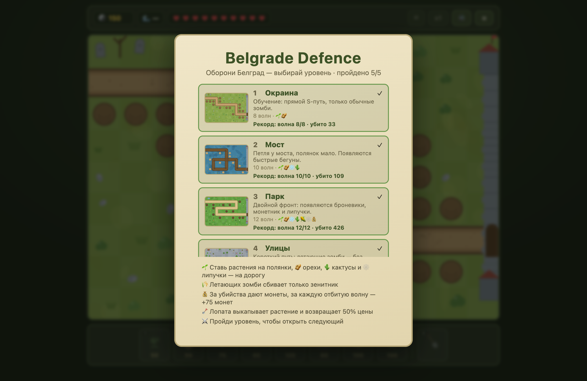
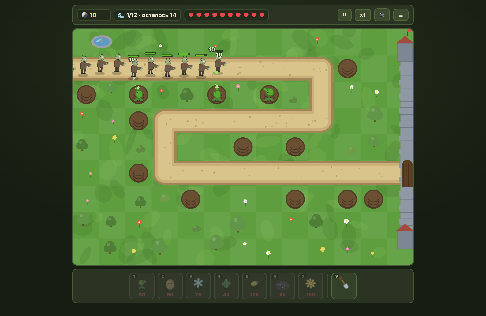
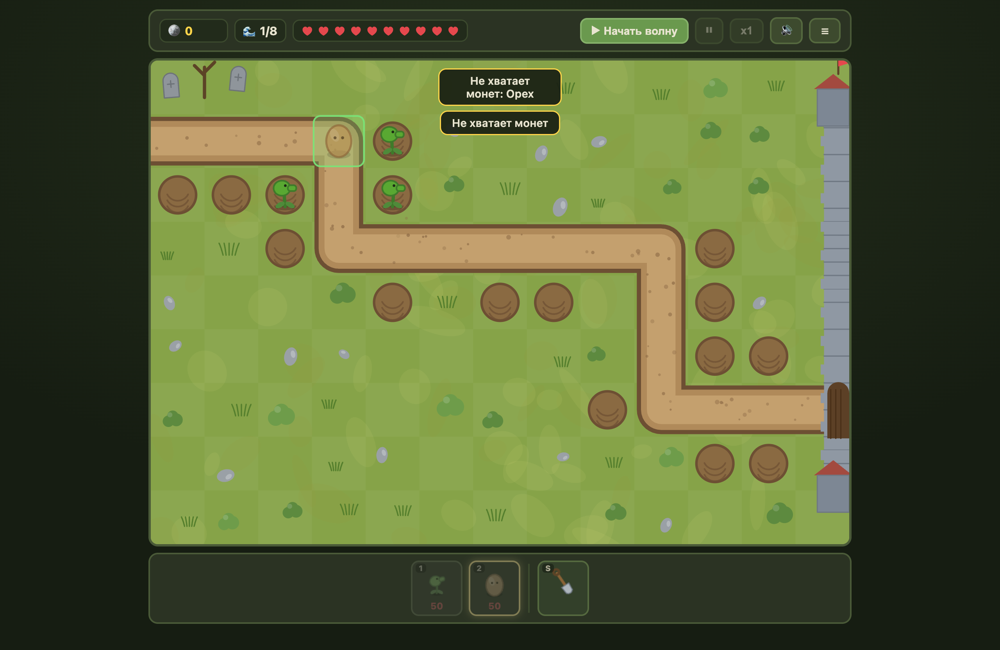
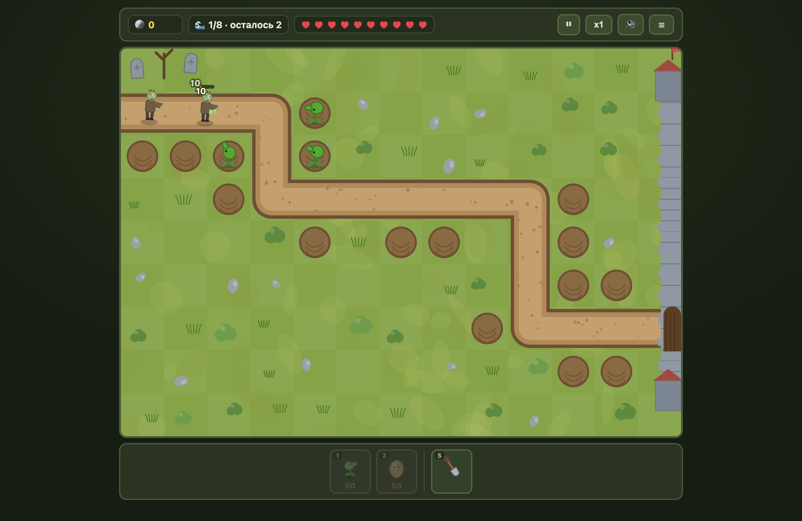

# Belgrade Defence

🇷🇺 Русский · 🇬🇧 [English](README.en.md)

Браузерный **волновой tower defense** в стиле «растения против зомби»: зомби идут по извилистой дороге к Белграду, ты обороняешь город растениями. Всё локально, без сети и без зависимостей — **vanilla JS (ES-модули) + Canvas 2D + DOM**.

- **6 уровней**: 5 сюжетных («Окраина», «Мост», «Парк», «Улицы», «Ворота Белграда») + бесконечный **Endless**.
- **8 растений** с постепенной разблокировкой: горохострел, орех, морозник, кактус-ловушка, мортирка, липучка, монетник, зенитник.
- **5 видов зомби**: обычный, бегун, броневик, летун и босс на 5000 HP.
- Волны, экономика, лопата с возвратом 50%, прогресс по уровням.

## Скриншоты

| Выбор уровня | Бой |
| :---: | :---: |
|  |  |

| Расстановка растений | Волна |
| :---: | :---: |
|  |  |

## Играть без установки

Играй сразу в браузере: **<https://krems.github.io/belgrade-defence/>**

Либо скачай файл **`belgrade-defence.html`** из раздела [**Releases → Latest**](https://github.com/krems/belgrade-defence/releases/latest) и открой его двойным кликом в браузере.

Это вся игра в одном файле: ни Node.js, ни npm, ни консоли не нужно. Прогресс в такой версии не сохраняется (нет сервера) — для сохранения запускай из исходников ниже.

## Запуск из исходников

Нужен только [Node.js](https://nodejs.org/) 18+ (для встроенного мини-сервера). Зависимостей нет.

```bash
git clone https://github.com/krems/belgrade-defence.git
cd belgrade-defence
npm start          # → http://localhost:8000
```

Или без npm:

```bash
node server.js     # → http://localhost:8000
```

Открой <http://localhost:8000>. Прогресс сохраняется в `data/progress.json` через `GET/POST /api/progress`.

## Сборка одиночного HTML

Собирает всю игру в один самодостаточный файл `dist/belgrade-defence.html` (тот самый релизный артефакт):

```bash
npm install
npm run build
```

## Управление

| Действие | Клавиша / кнопка |
| --- | --- |
| Выбрать растение | `1`–`8` или клик по карточке внизу |
| Лопата (выкопать, вернуть 50%) | `S` или `0` |
| Поставить / выкопать | клик по клетке |
| Отменить инструмент | `Esc` или правый клик |
| Начать волну | `Enter` или кнопка «Начать волну» |
| Пауза | `P` / `Space` |
| Ускорение x1/x2 | кнопка `x1` в HUD |
| Звук | `M` |

Растения ставятся на «полянки»; **орех, кактус и липучка** — только на дорогу. Летающих зомби сбивает **только зенитник**.

## Растения

| Иконка | Растение | Цена | Роль |
| --- | --- | --- | --- |
| 🌱 | Горохострел | 50 | стреляет в ближайшего (10 урона, 1/с, радиус 3) |
| 🥜 | Орех | 50 | на дорогу, 300 HP, зомби его грызут |
| ❄️ | Морозник | 75 | аура: −40% скорости и 2 урона/с |
| 🌵 | Кактус-ловушка | 40 | на дорогу, 8 урона/с проходящим |
| 🌽 | Мортирка | 125 | навесной сплеш 25 по площади |
| 🕸️ | Липучка | 60 | на дорогу: −45% скорости и 6 урона/с |
| 💰 | Монетник | 100 | +25 монет каждые 10 с |
| 🌾 | Зенитник | 100 | бьёт только летающих (5 урона, 3/с) |

## Уровни

| # | Уровень | Волны | Особенность |
| --- | --- | --- | --- |
| 1 | Окраина | 8 | обучение, только обычные зомби |
| 2 | Мост | 10 | появляются бегуны |
| 3 | Парк | 12 | броневики, монетник и липучки |
| 4 | Улицы | 14 | летающие зомби — нужен зенитник |
| 5 | Ворота Белграда | 15 | финальный босс 5000 HP |
| ∞ | Endless | ∞ | бесконечные волны, босс каждые 10 |

Уровни открываются по мере прохождения (Endless — после «Ворот»).

## Структура проекта

```
belgrade-defence/
├── index.html            # канвас + DOM-каркас UI
├── server.js             # статика + API прогресса (node:http, без зависимостей)
├── styles.css
├── tools/
│   ├── build-standalone.mjs  # сборка одного HTML в dist/
│   └── generate-levels.mjs   # генератор/автобаланс уровней
├── docs/screenshots/     # скриншоты для README
└── src/
    ├── main.js           # bootstrap + игровой цикл (fixed timestep)
    ├── state.js          # машина состояний MENU → PLANNING → WAVE → WIN/LOSE
    ├── balance.js        # все числовые константы
    ├── config.js         # замороженные уровни и волны (генерируется)
    ├── themes.js         # визуальные темы уровней
    ├── map.js, render.js, fx.js, audio.js, waves.js
    ├── entities/         # plant.js, zombie.js, projectile.js
    └── ui/               # hud.js, shop.js, screens.js
```

## Заметки

- Прогресс хранится **на сервере** в `data/progress.json` (в git не попадает). При запуске собранного HTML-файла прогресс не сохраняется.
- Уровни и волны заморожены в `src/config.js`; регенерация с автобалансом: `node tools/generate-levels.mjs`.
- Звук — процедурный WebAudio, без аудиофайлов. Графика — Canvas-примитивы, без ассетов.
